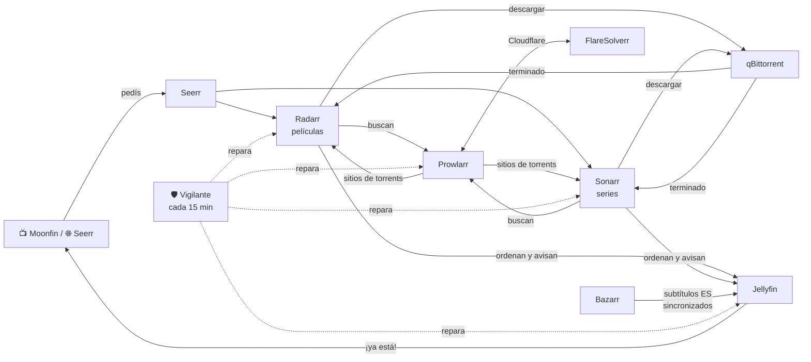

# 🎬 Servidor multimedia automatizado

Tu propio "Netflix" en casa: pedís una película o serie desde la tele o el celular, el servidor la busca, la descarga **con audio latino y subtítulos en español sincronizados**, la ordena y te avisa cuando está lista para ver. Todo automático y con un vigilante que repara solo lo que falle.

Probado en una notebook Acer Aspire 5750 (i5-2430M, 4 GB RAM) con Linux Mint 22.3. Si corre ahí, corre en casi cualquier cosa.

---

## Cómo funciona



| App | Puerto | Para qué sirve |
|---|---|---|
| **Jellyfin** | 8096 | Servidor donde mirás todo (como Netflix) |
| **Seerr** | 5055 | Página para buscar y pedir películas y series |
| **Radarr** | 7878 | Gestiona películas: busca, elige versión, ordena |
| **Sonarr** | 8989 | Lo mismo para series, episodio por episodio |
| **Prowlarr** | 9696 | Busca en los sitios de torrents (indexadores) |
| **FlareSolverr** | 8191 | Permite usar sitios protegidos por Cloudflare |
| **qBittorrent** | 8080 | Descarga los archivos |
| **Bazarr** | 6767 | Subtítulos en español, limpios y sincronizados |
| **Lidarr** *(opcional)* | 8686 | Música: discografías de artistas |
| **YT Music Sync** *(opcional)* | — | Tus Me gusta y playlists de YouTube Music en Jellyfin |

---

## Requisitos

| | Mínimo | Recomendado |
|---|---|---|
| RAM | 4 GB | **8 GB** (con 4 GB funciona, pero va justo) |
| Disco | Cualquiera | **SSD** para el sistema; espacio según tu biblioteca |
| Sistema | Ubuntu 22.04+, Debian 12+ o Linux Mint 21+ | |
| Red | | **Cable** (no WiFi) |

---

## Instalación

```bash
git clone https://github.com/Alghulgit94/servidor-multimedia.git
cd servidor-multimedia
sudo bash install.sh
```

El instalador:
1. Instala Docker si no lo tenés.
2. Crea el archivo `.env` y detecta la IP del servidor.
3. Te pide **usuarios y contraseñas** (qBittorrent, Jellyfin y, opcional, OpenSubtitles.com). No se guardan en ningún archivo.
4. Levanta todos los contenedores.
5. Configura **todo** en orden (ver [Scripts](#scripts)).

Tarda entre 10 y 30 minutos según la conexión y el equipo. Si algún paso falla, se puede repetir solo ese paso (ver [Scripts](#scripts)); ninguno duplica lo que ya hizo.

> **Antes de instalar**, revisá `.env.example`. Podés cambiar la carpeta de datos (`DATA_DIR`), la zona horaria y el modo de audio. El instalador copia ese archivo como `.env` la primera vez.

### Después de instalar

- **Radarr, Sonarr, Prowlarr y Bazarr** te piden crear un usuario la primera vez que los abrís en el navegador. Elegí *Forms (Login Page)* y dejá *Allowed Hosts* vacío.
- Si querés usar la **app Moonfin en la tele**, seguí [Moonfin en la TV](#moonfin-en-la-tv).

---

## Uso diario

1. Abrí **Moonfin** en la tele (o **Seerr** en el navegador: `http://IP:5055`).
2. Buscá la película o serie y tocá **Solicitar**.
3. Cuando esté lista te llega el aviso. Tocalo y se reproduce.

Para las series, Sonarr descarga solo los episodios nuevos a medida que salen.

---

## Idioma y subtítulos

| Qué | Cómo se resuelve |
|---|---|
| **Audio latino** | Radarr y Sonarr solo aceptan versiones con *Latino/LAT/LATAM* en el nombre (`AUDIO_MODO=exigir`) o las prefieren (`preferir`) |
| **Inglés + latino** | Se priorizan las versiones *Dual/Multi*: un solo archivo con los dos audios |
| **Subtítulos** | Bazarr baja subtítulos en español (Subdivx, Podnapisi y OpenSubtitles.com) |
| **Sincronización** | Cada subtítulo se alinea solo con el audio de la película |
| **Limpieza** | Se quitan etiquetas como *[música]* o *[risas]* |
| **Al reproducir** | Audio en inglés con subtítulos en español automáticos (modo *Inteligente*). Al cambiar a latino, los subtítulos se ocultan |

En el modo `exigir`, si una película todavía no tiene versión latina, la solicitud queda esperando y se descarga sola cuando aparezca. Se cambia con `AUDIO_MODO` en `.env` y luego `sudo bash scripts/07-configurar-idioma.sh`.

---

## Automatización y autorreparación

| Situación | Quién lo resuelve |
|---|---|
| Termina una descarga | Radarr/Sonarr la importan y avisan a Jellyfin al instante |
| Llega un subtítulo | Bazarr lo sincroniza, lo limpia y avisa a Jellyfin |
| Aparece una versión mejor (latina dual) | Radarr/Sonarr la reemplazan solos |
| Jellyfin no detectó algo | Escaneo automático cada hora |
| Un contenedor se apaga o se cuelga | El **vigilante** lo enciende o reinicia |
| Indexadores desactivados por fallos | El vigilante los reactiva |
| Pedidos que no se encontraron | Búsqueda automática cada madrugada (04:00) |
| Poco espacio en disco | Queda anotado en el registro del vigilante |

El vigilante es un servicio de systemd que corre cada 15 minutos:
```bash
sudo tail -20 /var/log/media-vigilante.log      # qué reparó
systemctl list-timers media-vigilante.timer     # cuándo vuelve a correr
```

---

## Música y YouTube Music

**Activar la música (Lidarr):** en `.env` poné `MUSICA=si` y ejecutá `sudo bash install.sh` (o, en un servidor ya instalado: `sudo docker compose --profile musica up -d`, `sudo bash scripts/02-configurar-arr.sh` y `sudo bash scripts/09-instalar-automatizacion.sh`). En Lidarr (`http://IP:8686`) buscás un artista y descarga sus álbumes. Seerr y Moonfin no piden música.

**Sincronizar YouTube Music** (`sudo bash scripts/12-instalar-ytmusic.sh`):

| Qué | Cómo |
|---|---|
| **Canciones** | Cada 3 horas descarga tus **Me gusta** y las **playlists que elijas**, con artista, álbum y carátula (calidad Premium si tenés Premium) |
| **Playlists** | Se crean en Jellyfin como *"Nombre (YT Music)"* y se mantienen iguales: lo que agregás o sacás en YT Music se refleja |
| **De a poco** | Descarga en tandas de 25: después de cada tanda, las canciones y las playlists ya aparecen en Jellyfin |
| **Artistas** | Si Lidarr está activo, los artistas con varias canciones tuyas (por defecto 3) se agregan solos para bajar su discografía |
| **Carpeta** | `data/media/ytmusic`, dentro de la biblioteca Música de Jellyfin |

Necesita las **cookies** de tu cuenta, exportadas desde una ventana de **incógnito** (el script explica cómo). Cuando vencen, queda anotado en el registro del vigilante; se renuevan volviendo a ejecutar el script.

```bash
sudo tail -f /var/log/ytmusic-sync.log     # progreso
sudo systemctl start ytmusic-sync          # sincronizar ya
```

> ⚠️ Las cookies dan acceso a tu cuenta de Google: quedan solo en el servidor (`AppData/ytmusic`, permisos restringidos). Nunca las subas al repo. Descargar de YouTube va contra sus términos de uso.

---

## Moonfin en la TV

[Moonfin](https://github.com/Moonfin-Client/Moonfin-Core) es una app de Jellyfin con Seerr integrado: buscás, pedís y mirás en **una sola app**, sin escribir direcciones IP, y te avisa cuando la película está lista. Está para Android TV / Google TV, Fire TV, Apple TV, Windows, celulares y web.

**1. Plugin en el servidor** (el instalador lo instala si respondiste *s*; si no: `sudo bash scripts/10-instalar-moonbase.sh`). Después, en Jellyfin → **Panel de control → Plugins → Moonbase**:
- **Integrations** → activar **Seerr** → *Seerr URL*: `http://seerr:5055`
- **User defaults** → **Moonbase Sync** activado
- **Web Client → Connecting to this server** → *Public Server URL*: `http://IP:8096`
- **Save**

**2. En la TV:** instalá **Moonfin**, conectate al servidor (iniciando sesión o con *Conexión rápida*) y andá a **Ajustes → Integraciones → Seerr → activar → Iniciar sesión → Jellyfin**.

Sin app: `http://IP:8096/Moonfin/Web/` en el navegador de la tele.

---

## Usuarios de la casa

1. Jellyfin → **Panel de control → Usuarios → +**.
2. Seerr → **Usuarios → Importar usuarios de Jellyfin** y darles permiso para **Solicitar**.
3. Cada uno inicia sesión en Moonfin con su usuario.

---

## Scripts

Todos se ejecutan con `sudo bash scripts/NOMBRE.sh` y se pueden repetir sin duplicar nada.

| Script | Qué hace |
|---|---|
| `01-configurar-qbittorrent.sh` | Usuario, carpetas, cola, límites, dominios permitidos y categorías |
| `02-configurar-arr.sh` | Conecta qBittorrent y crea las carpetas en Radarr/Sonarr/Lidarr; los conecta a Prowlarr |
| `03-configurar-flaresolverr.sh` | Conecta FlareSolverr a Prowlarr |
| `04-agregar-indexadores.sh` | Prueba el catálogo de Prowlarr y deja solo los indexadores que funcionan (sin anime) |
| `05-configurar-jellyfin.sh` | Asistente inicial en español y bibliotecas |
| `06-configurar-seerr.sh` | Conecta Seerr con Jellyfin, Radarr y Sonarr |
| `07-configurar-idioma.sh` | Reglas de audio latino y dual |
| `08-configurar-final.sh` | Avisos a Jellyfin, Bazarr y preferencias de reproducción |
| `09-instalar-automatizacion.sh` | Bazarr → Jellyfin, escaneo cada hora y el vigilante |
| `10-instalar-moonbase.sh` | *(Opcional)* Plugin Moonbase para Moonfin |
| `11-sincronizar-subtitulos.sh` | Re-sincroniza todos los subtítulos existentes |
| `12-instalar-ytmusic.sh` | *(Opcional)* Sincronización de YouTube Music y artistas a Lidarr |

---

## Carpetas

```
DATA_DIR (por defecto /DATA)
├── AppData/            ← configuración de cada app (hacé backup de esto)
│   ├── jellyfin/  radarr/  sonarr/  prowlarr/  bazarr/  seerr/  qbittorrent/
│   └── ytmusic/        ← cookies y estado de YT Music (privado, no compartir)
└── data/
    ├── torrents/       ← descargas en curso (movies, tv, music)
    └── media/          ← biblioteca final ordenada (movies, tv, music, ytmusic)
```

---

## Mantenimiento

```bash
# Actualizar todas las apps
sudo docker compose pull && sudo docker compose up -d

# Backup de la configuración
sudo tar czf backup-appdata-$(date +%F).tar.gz -C /DATA AppData

# Activar música (Lidarr): MUSICA=si en .env y luego
sudo docker compose --profile musica up -d
sudo bash scripts/02-configurar-arr.sh
sudo bash scripts/09-instalar-automatizacion.sh   # para que el vigilante lo cuide

# Ver qué contenedores están corriendo
sudo docker ps --format "table {{.Names}}\t{{.Status}}"
```

---

## Solución de problemas

Problemas reales que aparecieron durante el armado, y su solución.

| Síntoma | Causa | Solución |
|---|---|---|
| El instalador de Docker falla en Linux Mint ("paquetes rotos") | El script oficial confunde Mint con Debian | `install.sh` usa `docker.io` de los repositorios del sistema |
| Radarr: *Unable to connect to qBittorrent* | Validación de encabezado Host | `01-configurar-qbittorrent.sh` agrega `qbittorrent` a los dominios permitidos |
| Radarr: *No results found* al instante / *0 active indexers* | Radarr desactivó los indexadores tras varios *timeouts* | El vigilante los reactiva solo |
| *Http request timed out* en las búsquedas | Equipo con poca RAM usando swap y FlareSolverr resolviendo Cloudflare | Más RAM; la segunda búsqueda es más rápida porque Cloudflare queda resuelto |
| El botón *Reproducir en Jellyfin* de Seerr no abre | Seerr usaba el nombre interno `jellyfin` | `06-configurar-seerr.sh` configura la URL externa con la IP |
| Bazarr: *All providers are throttled* | Algún proveedor dio error y quedó pausado | Revisar **System → Providers** en Bazarr y tocar **Reset** |
| OpenSubtitles: *Login failed* | Se usó la cuenta de **opensubtitles.org** | Hace falta una cuenta de **opensubtitles.com** (son sitios distintos) |
| Subtítulo desfasado | Subtítulo de otra versión del video | La sincronización automática lo corrige; para los viejos: `scripts/11-sincronizar-subtitulos.sh` |
| Jellyfin no muestra algo nuevo | Su monitor no detecta cambios hechos por otro contenedor | Ya resuelto con los avisos directos y el escaneo horario |
| YT Music: *las cookies no funcionan* | Se exportaron de una ventana normal (YouTube las renueva) o la extensión no corre en incógnito | Permitir la extensión en incógnito (`chrome://extensions` → Detalles) y exportar desde una ventana de incógnito que después se cierra |
| Una playlist "Mix" aparece con 0 canciones | Los Mix son radios automáticas de YouTube, no playlists reales | Guardar esas canciones en una playlist propia |
| Jellyfin responde *401* a pedidos con clave | Las versiones nuevas no aceptan `?api_key=` | Los scripts usan `?ApiKey=` (formato nuevo) |
| Un comando parece colgado | Está esperando la contraseña de `sudo` (no se ve al escribir) | Escribila y apretá Enter |

---

## Aviso legal

Este proyecto solo instala y configura software libre y legal. **Descargar material con derechos de autor sin permiso es ilegal en la mayoría de los países.** Cada persona es responsable de qué descarga y de cumplir las leyes de su país. Las herramientas sirven igual para contenido libre o de dominio público.

## Licencia

[MIT](LICENSE)
